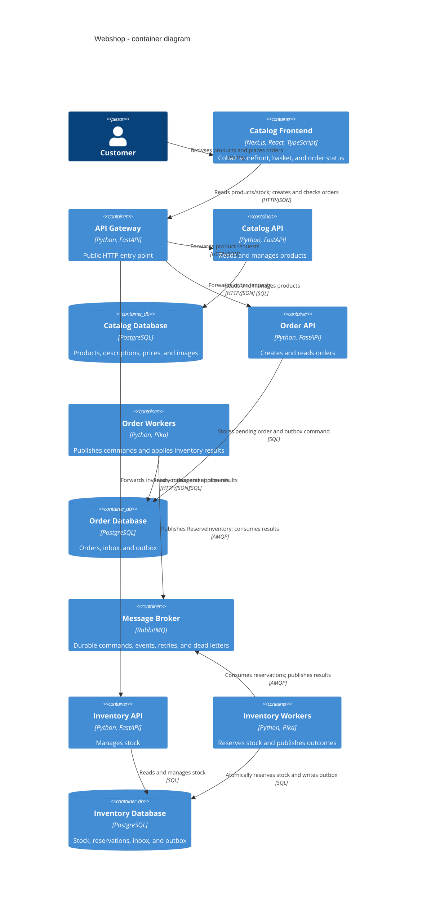

# C4 container view: asynchronous order reservation

RabbitMQ provides at-least-once delivery. The inbox tables, unique reservation
per order, and idempotent state transitions provide exactly-once business
effects. Infrastructure failures leave an order pending for recovery.
